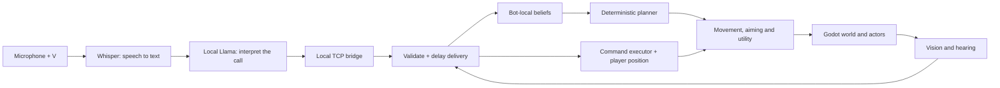

# Comm Bot — Callout Trainer

A first-person tactical communication game built for the Riot Games track at DevHacks 2026. In this project, we took the final round of the PRX vs. FNC Masters Toronto grand finals and recreated the scenario with AI gameplay bots. The player plays as PRX something and can communicate to an AI teammate to ask for utility, initiate a double swing, or provide information. The gameplay bots operate on limited information and change their actions based on player voice input, encouraging precise and consistent communication.

Built with Godot 4.4.1, GDScript, Python, local Whisper speech recognition, and
Llama 3.1 through Ollama. No paid API or model training is required.

## Run the game

The supported demo runs on **Windows with an NVIDIA CUDA GPU and a microphone**.
Install the dependencies once using [the setup guide](docs/SETUP.md). The launcher
expects Godot, a Python voice environment, and cached models at the documented paths.

From the repository in PowerShell:

```powershell
.\validation\run_voice_game.ps1
```

Wait for `Game connected` and `Hold V to speak`. The launcher warms the models,
opens Godot, and connects the microphone host. Close the game when finished.

**Use this launcher for the complete demo.** Running `project.godot` directly or
using `run_game.bat` opens the original authoring sandbox without the voice scenario.

## Play a round

You and your teammate defend a planted spike on a seven-zone Lotus B-site greybox map.
You start in Heaven; the teammate and spike start in Pit. The round begins at plant,
and four enemies enter at their first annotated positions, 23 seconds later.

Hold **V**, speak, then release to send a call. Try:

| Say | Teammate behavior |
|---|---|
| "Two on Heaven" | Updates its working information about that region |
| "I think someone's B Main" | Receives an enemy report with your stated uncertainty |
| "Play Heaven with me" | Travels to Heaven and holds it until a new position or cancel |
| "Let's push A Link together" | Moves toward A Link and retains that position |
| "Get ready to swing Heaven" | Moves to the authored staging position and waits for your cue |
| "Swing" or "go" | Releases a prepared, ready action |
| "Flash C Link" | Turns and checks visibility/range, throwing from here if possible; otherwise seeks a throwing position |
| "Flash C Link on my cue" | Prepares the flash and waits for "go" |
| "Cancel" | Cancels a pending action or releases a held positioning goal |

Locations are **Main, Cubby, Heaven, Upper, Pit, C Link, and A Link**. Use a clear
location in each instruction. Ambiguous or unsupported calls may require clarification;
there is no teammate molly voice command. The teammate has one commanded flash per round.

Hold until the spike detonates, or eliminate all four enemies. Defuse or losing both
friendly actors ends the round in defeat. If you die while your teammate survives,
you can still give voice reports. Press **F** for a fresh round.

## Controls

| Input | Action |
|---|---|
| WASD / mouse | Move / look |
| Left mouse / R | Fire / reload |
| Space / Ctrl / Shift | Jump / crouch / walk |
| B | Dash |
| Hold V | Push to talk; release to send |
| Q / E | Player smoke / flash |
| X / G / T | Phoenix Hot Hands / Omen Paranoia / Fade Haunt |
| F | Restart the round |
| Esc | Release or recapture the mouse |
| F1 / F2 | Toggle player HUD / teammate information panel |

HP and ammo appear in the status text. The teammate panel exposes its information
and current actions. Blinded bots cannot shoot, and dead bots disappear with their
hitboxes disabled. Completed player movement retains its destination instead of
automatically returning to the spike.

## How it works



Python handles speech and language work outside the game's physics thread. The LLM
interprets the call; **deterministic code selects and executes goals** in the demo.
Godot stamps receipt time and delays communication delivery by 18 physics ticks.
Preparing an action, being ready, releasing it, and completing it are separate states.

Bots start with authored movement and utility beats, then react to delivered evidence
and your calls. Physical adapters handle navigation, collision, shots and throws;
policies receive copied observations and permitted own-state rather than live enemy
transforms. Smoke, blindness, visibility and reaction delay constrain their knowledge.

The launcher builds a temporary Godot project from pinned shared-source snapshots
and current local scripts. This keeps the demo's map, belief module, voice integration,
and gameplay changes together without changing the root authoring scene.

## Repository guide

| Location | Purpose |
|---|---|
| `scenes/bots/` | Scenario lifecycle, teammate runtime wiring and voice TCP bridge |
| `bots/` | Python voice host, planners, command execution, combat and motion |
| `perception/` | Vision/hearing sensors, copied observations and delayed inbox |
| `actors/`, `scenes/player/`, `weapons/`, `utility/` | Shared physical gameplay |
| `world/`, `world/maps/` | JSON map builders, zones and navigation |
| `scenarios/` | Spawn schedule, authored baseline, positions and command targets |
| `schemas/`, `examples/` | Communication contracts and sanitized fixtures |
| `validation/`, `tests/person2/` | Launchers, integration builders and regression tests |
| `recording/`, ignored `runs/` | Gameplay events and local diagnostic records |

Read [setup and troubleshooting](docs/SETUP.md), [architecture](docs/ARCHITECTURE.md),
[scenario behavior](docs/SCENARIO.md), [communication contracts](docs/COMMANDS.md),
or [testing](docs/TESTING.md) for more detail. Contributors should start with
[CONTRIBUTING.md](CONTRIBUTING.md).

## Hackathon scope

This is the runnable source-based hackathon demo. The map and utility are authored
approximations; the game does not force a recorded professional match outcome.
Automatic coaching scores, debriefs, a packaged voice-enabled desktop export, and
experimental LLM goal selection are outside the supported demo path.

Speech processing and interpretation run locally after initial dependency/model
downloads. Raw microphone audio stays in memory; transcripts and model/decision
logs are stored locally under ignored `runs/` directories. Model weights stay outside
Git. An OS-network-disabled deployment has not been independently verified.

Independent simulator; not affiliated with Riot Games. No game-client access,
extracted game assets, or replay scraping is required. Third-party model terms apply;
see [contribution guidance](CONTRIBUTING.md) before redistributing.
